# Not Your Dungeon


RPG tático por turnos em 2D, desenvolvido em **Godot**, no qual o jogador controla monstros que lutam contra as inquisições humanas e buscam recuperar a liberdade de escolher seu próprio destino.

Projeto acadêmico em desenvolvimento. A versão atual concentra-se na primeira fase da masmorra Caverna Destruída. O GDD descreve também as funcionalidades planejadas para o jogo completo.

## Como executar

1. Abra a Godot 4 (o README original indica a versão 4.7.2).
2. Importe o arquivo `project.godot` na raiz do repositório.
3. Pressione **F5** para iniciar o jogo.

## Controles

| Tecla | Ação |
|---|---|
| WASD / setas direcionais | Movimentação durante a exploração |
| Setas direcionais | Navegação nos menus de combate |
| Z | Interagir, confirmar e avançar diálogos |
| X | Voltar ou cancelar |

## Protótipo atual

A primeira fase apresenta cinco ambientes conectados, com exploração em perspectiva superior 3/4, cenários em pixel art, diálogos com retratos e combates em telas próprias.

| Tela | Cenário | Acontecimento |
|---|---|---|
| 1 | Sala do trono | Zork ordena que Spike colete cristais. |
| 2 | Corredor | Exploração e passagem para a câmara dos cristais. |
| 3 | Câmara dos cristais | Spike minera o cristal dourado; na terceira interação, uma flecha atinge o cristal e revela a invasão. |
| 4 | Sala de resgate | Spike enfrenta um lacaio e um arqueiro, coleta a chave após a vitória e liberta Gordot. Após o diálogo, Gordot entra para a equipe e acompanha Spike. |
| 5 | Sala final | Apresentação do líder e batalha de Spike e Gordot contra o líder, um lacaio e um arqueiro. |

### Cenários

| Sala do trono | Corredor |
|---|---|
| 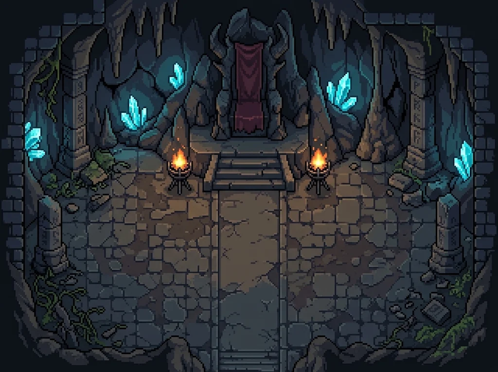 | 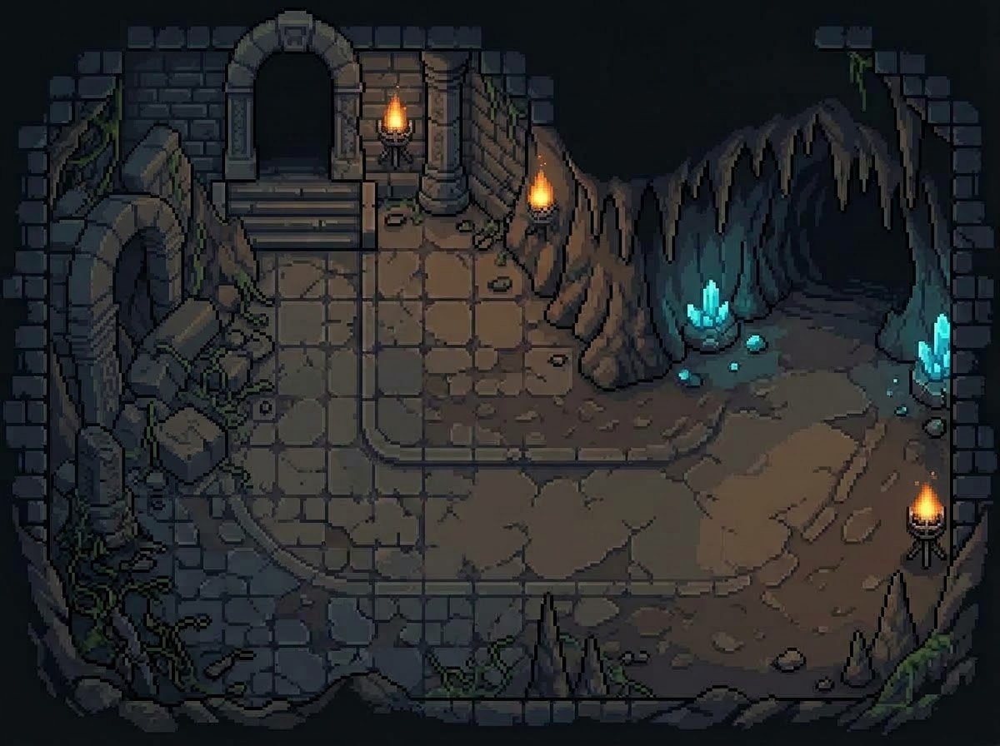 |

| Câmara dos cristais | Sala de resgate |
|---|---|
| 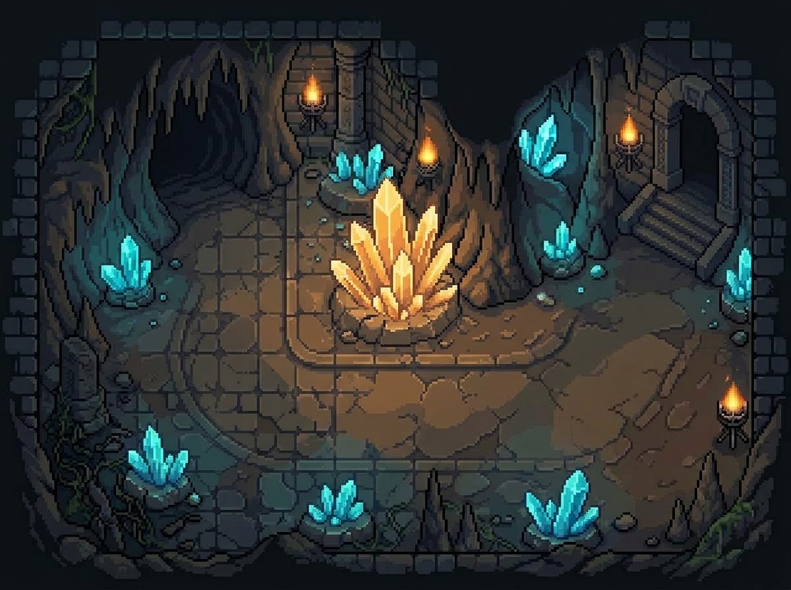 | 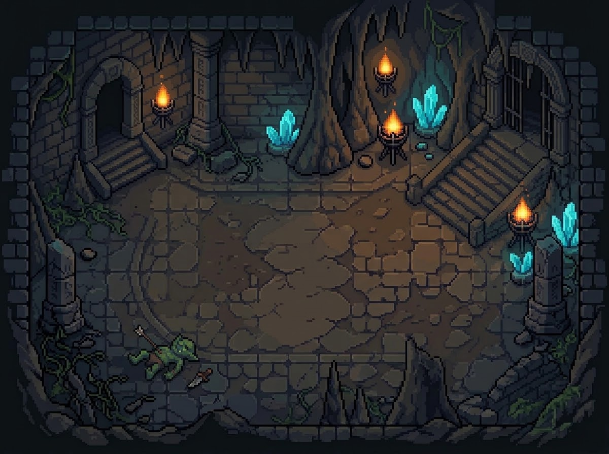 |

| Sala final |
|---|
| 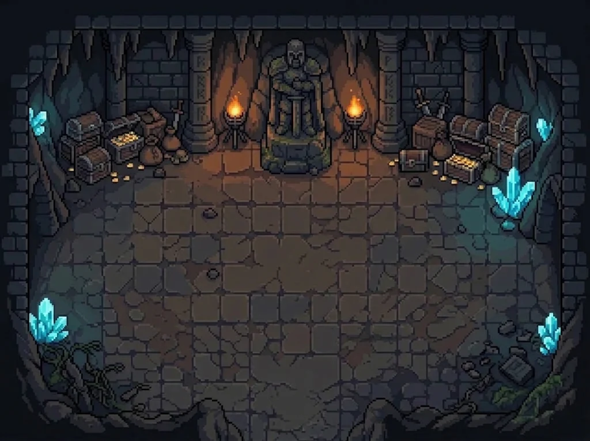 |

## Personagens

| Personagem | Aparência | Especialidade / função | Habilidade |
|---|---|---|---|
| Spike | Réptil verde com cimitarra e cachecol roxo | Agilidade; age primeiro | Investida Esmeralda |
| Gordot | Ogro roxo com tronco de madeira | Defesa; bônus de vida | Impacto Colossal |
| Thyr | Armadura vazia com garra e espada flamejantes | Magia (planejado) | Onda Infernal (planejada) |
| Zork | Cavaleiro de armadura escura, lança e aura ciano | Imperador da masmorra, NPC | Lâminas Espectrais do Imperador (planejada para combate) |

| Spike | Gordot | Thyr | Zork |
|---|---|---|---|
| 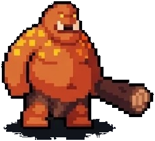 | 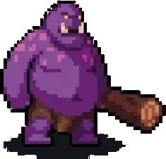 | 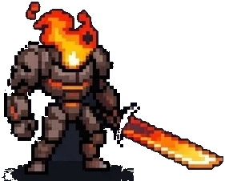 | 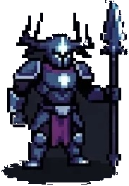 |

### Inimigos

| Mercenário lacaio | Mercenário arqueiro | Mercenário líder |
|---|---|---|
| 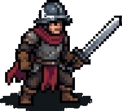 | 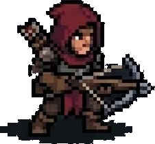 | 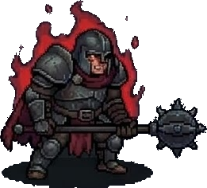 |
| Combatente corpo a corpo com espada | Combatente à distância com besta | Chefe com maça pesada e sprite próprio |

## Sistema de combate

Combate por turnos, sem grade de movimentação. A ordem das ações considera a velocidade das unidades. As ações disponíveis incluem ataque básico, defesa, habilidade especial, item e fuga (quando permitida pelas regras do encontro).

- **Investida Esmeralda:** custa 8 SP, possui multiplicador de ataque de 1,5 e inicia a combinação com Gordot.
- **Impacto Colossal:** custa 10 SP, possui multiplicador de ataque de 1,7 e provoca os inimigos por dois turnos, com redução de 30% no dano recebido.
- **Investida Dupla:** combo ativado quando Spike utiliza Investida Esmeralda e Gordot utiliza Impacto Colossal na mesma rodada, nessa ordem. Causa dano adicional aos inimigos.
- **Defesa:** reduz o dano recebido em 50%.
- **Poção:** recupera 40 HP.

### Atributos do protótipo

| Unidade | HP máximo | SP | Ataque | Defesa | Velocidade |
|---|---:|---:|---:|---:|---:|
| Spike | 120 | 40 | 20 | 6 | 14 |
| Gordot | 192 | 30 | 16 | 10 | 4 |
| Lacaio | 45 | 0 | 12 | 4 | 8 |
| Arqueiro | 35 | 0 | 14 | 2 | 10 |
| Líder | 190 | 0 | 17 | 8 | 6 |

Os valores são provisórios e devem ser conferidos em `scripts/combate/banco_dados.gd`, fonte de referência para o balanceamento. O HP de Gordot inclui o bônus de 20% sobre sua vida base de 160.

## Arte e animações

Os recursos atuais utilizam pixel art. As folhas de personagens contêm animações de combate e exploração, incluindo poses de guarda, ataques, habilidades, defesa, dano, vitória, derrota e movimentação. A presença de uma animação na folha não significa necessariamente que sua mecânica já foi implementada.

As folhas originais usam grades de 3 colunas por 4 linhas e ficam em `arte/sprites_originais/`. Personagens que não participam da exploração podem possuir somente folhas de combate.

Para processar as folhas:

```bash
python -m pip install numpy pillow
python ferramentas/importar_sprites.py
```

O importador remove o fundo, separa os quadros, gera folhas PNG com transparência e metadados JSON de animação, além de prévias. A remoção do fundo depende da cor e da organização das folhas originais.

Os nomes seguem o padrão `<personagem>_combate1.png`, `<personagem>_combate2.png` e `<personagem>_exploracao.png`, sem acentos ou espaços.

## Organização do código

| Caminho | Responsabilidade |
|---|---|
| `cenas/` | Cenas da Godot |
| `scripts/combate/banco_dados.gd` | Atributos, habilidades e combos |
| `scripts/combate/combate.gd` | Turnos, interface, regras e encontros |
| `scripts/combate/combatente.gd` | Unidades em batalha, vida, dano e animações |
| `scripts/exploracao/jogador.gd` | Movimentação, animações e limites caminháveis |
| `scripts/exploracao/sala_do_trono.gd` | Diálogo inicial com Zork |
| `scripts/exploracao/corredor.gd` | Exploração e transição |
| `scripts/exploracao/camara_cristais.gd` | Mineração e emboscada |
| `scripts/exploracao/sala_resgate.gd` | Primeiro encontro, chave, diálogo e recrutamento |
| `scripts/exploracao/sala_final.gd` | Apresentação do chefe e início do confronto final |
| `scripts/exploracao/transicao_combate.gd` | Efeito visual reutilizável de entrada em batalha |
| `scripts/comum/folha_sprites.gd` | Carregamento das animações |
| `ferramentas/importar_sprites.py` | Processamento dos sprites |
| `arte/` | Recursos visuais |
| `audio/` | Recursos sonoros |
| `docs/` | GDD e documentação |

## Desenvolvimento futuro

- Encerramento narrativo da primeira fase, refinamento do balanceamento e efeitos sonoros.
- Substituição do marcador provisório da chave pelo sprite definitivo.
- Aprimoramento das animações de ataque e dos projéteis durante o combate.
- Magias com MP, stagger, moral, acertos críticos com interação de tempo, progressão e equipamentos.
- Novas fases, monstros recrutáveis e gerenciamento da equipe.

O GDD contém a visão ampliada do jogo; nem todos os sistemas descritos nele estão disponíveis no protótipo.

## Documentação

- [GDD completo](docs/GDD_Not_your_Dungeon.docx)
- [Resumo do GDD](docs/GDD.md)

## Equipe

- Cesar Sapha
- Vitor Souza
- Tales Fernandes
- Pietro Pelozato Maeda
