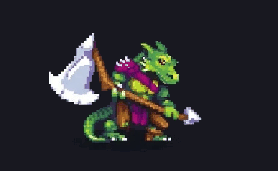
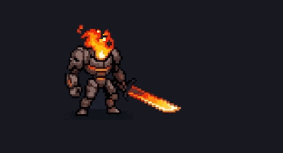
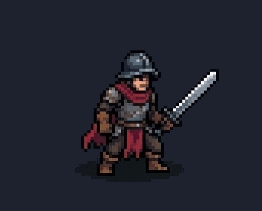
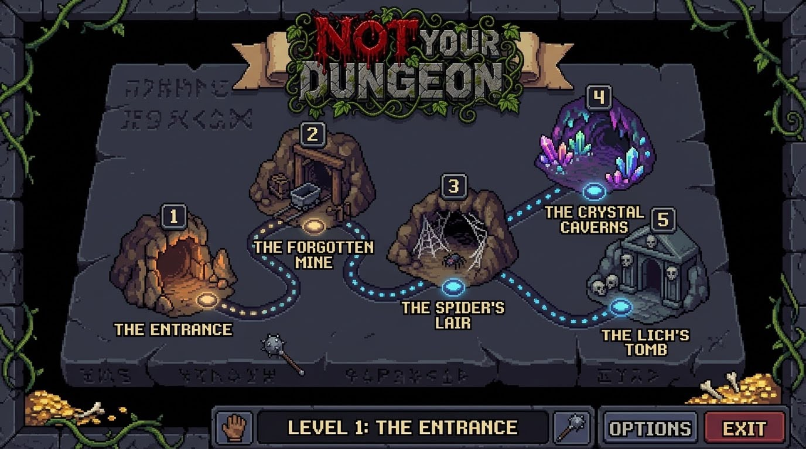
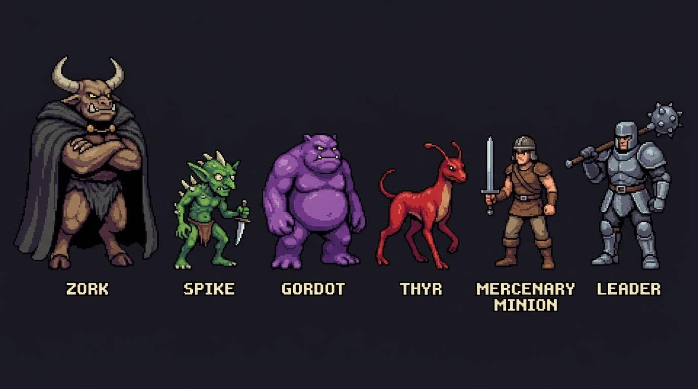
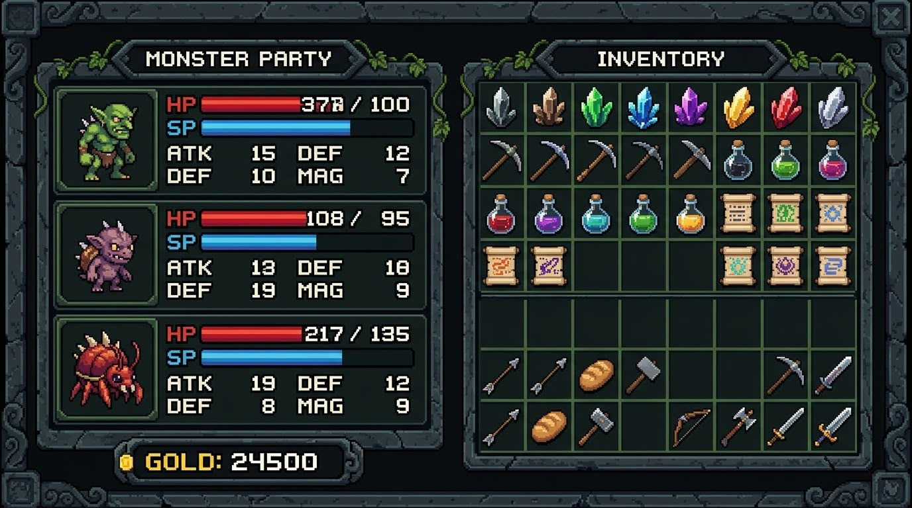
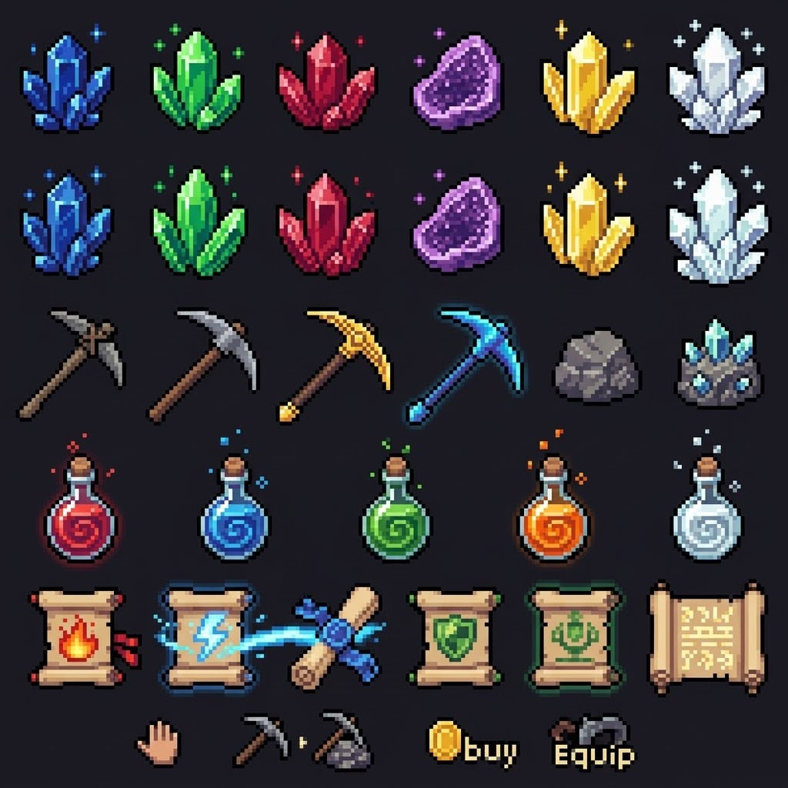
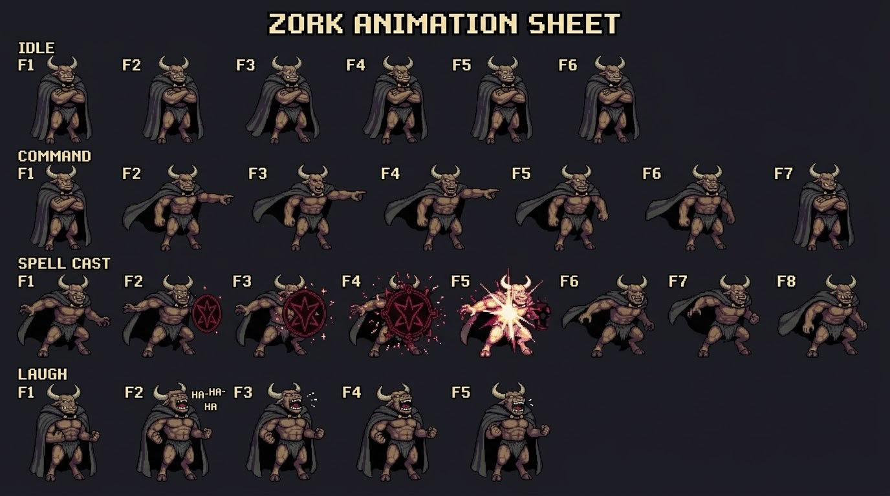

# Not your Dungeon


RPG tático por turnos em 2D, feito em **Godot**. O jogador comanda os **monstros da masmorra** contra as inquisições humanas, lutando pela liberdade de cada monstro escolher o próprio destino.

> Projeto acadêmico. O GDD completo está em [`docs/GDD_Not_your_Dungeon.docx`](docs/GDD_Not_your_Dungeon.docx) e o resumo em [`docs/GDD.md`](docs/GDD.md).

## Personagens (sprites atuais)


| Personagem | Aparência (sprites) | Atributo (GDD) | Habilidade única |
|---|---|---|---|
| **Spike** | réptil com cimitarra, cachecol roxo e cauda | vida adicional | Investida Esmeralda |
| **Gordot** | ogro roxo com tronco de madeira | grande velocidade, age primeiro | Investida Relâmpago |
| **Thyr** | armadura vazia com chama saindo da gola, garra e espada de fogo | ganha mais experiência | Onda Infernal |
| **Zork** | cavaleiro escuro com elmo de chifres, lança e aura ciano | chefe da masmorra (não jogável) | Lâminas Espectrais do Imperador |

NPCs e inimigos: **Mercenário** ([folha](arte/personagens/folhas/mercenario_folha.png)), **Vendedor** e **Animal de carga** ([`arte/personagens/npcs/`](arte/personagens/npcs/)).

## Animações (sprite sheets)

| Spike | Gordot | Thyr | Zork | Mercenário |
|---|---|---|---|---|
|  |  |  |  |  |

Desenhadas pela equipe (documento `sprites.docx`), em 3 folhas por personagem com grade de 3x4:

| Folha | Animações |
|---|---|
| combate 1 | guarda (parado), atacar, habilidade/combo, magia, item |
| combate 2 | defender, dano, stagger, derrota, vitória |
| exploração | andar de frente, de costas, de lado (a esquerda é o lado direito espelhado), interação, resgate/especial, alerta (!), retrato |

Folhas com o nome de cada animação: [Spike](arte/personagens/folhas/spike_folha.png), [Gordot](arte/personagens/folhas/gordot_folha.png), [Thyr](arte/personagens/folhas/thyr_folha.png), [Zork](arte/personagens/folhas/zork_folha.png), [Mercenário](arte/personagens/folhas/mercenario_folha.png).

- As folhas **originais** ficam em [`arte/sprites_originais/`](arte/sprites_originais/), junto com o cenário da sala do trono e as folhas de assets.
- [`ferramentas/importar_sprites.py`](ferramentas/importar_sprites.py) troca o fundo por transparência **sem alterar o desenho**. Ele também apaga os títulos escritos sobre algumas folhas e reorganiza tudo em `<nome>_sprites.png` + `<nome>_sprites.json` (uma animação por linha, com fps e posição do pé), que é o que o jogo lê.
- Se uma folha mudar, substitua o arquivo em `arte/sprites_originais/` (mesmo nome) e rode `python ferramentas/importar_sprites.py`.

## Arte conceitual (primeira versão)

Rascunhos visuais da primeira fase do projeto. **Atenção:** nesta versão o Spike era um goblin e o Gordot um ogro roxo. A aparência atual é a da seção acima. Ficam em [`arte/conceitos/`](arte/conceitos/).

### Menu inicial


### Mapa das masmorras


### Personagens


### Sala do trono (Fase 1, Tela 1)


### Combate


### Grupo e inventário


### Itens e armas
| Itens | Armas |
|---|---|
|  |  |

## Folhas de animação (primeira versão)

### Spike


### Gordot


### Zork


### Mercenários (Lacaio e Líder)


## Equipe

- Cesar Sapha
- Vitor Souza
- Tales Fernandes
- Pietro Pelozato Maeda

## Estrutura do repositório

| Pasta | Conteúdo |
|---|---|
| `docs/` | GDD e documentação |
| `arte/personagens/monstros/` | Monstros jogáveis (Spike, Gordot, Thyr, Zork...) |
| `arte/personagens/herois/` | Heróis humanos |
| `arte/inimigos/` | Mercenário Lacaio, Mercenário Líder... |
| `arte/cenarios/masmorra_1/` | Caverna Destruída |
| `arte/ui/` | Interface, caixas de diálogo, ícones |
| `arte/conceitos/` | Rascunhos e concept art (primeira versão) |
| `arte/referencias/` | Imagens de referência de cada personagem e do cenário |
| `arte/sprites_originais/` | Folhas de sprites originais da equipe (fonte) |
| `arte/personagens/npcs/` | Vendedor e animal de carga |
| `ferramentas/` | Script que importa as folhas de sprites |
| `scripts/comum/` | Código compartilhado (montagem das animações) |
| `scripts/exploracao/` | Exploração: jogador e sala do trono |
| `animacoes/` | Sprite sheets e arquivos de animação |
| `audio/` | Músicas e efeitos sonoros |

## Protótipo atual

Feito em **Godot 4.7.2**. Para jogar, abra a Godot, clique em **Importar**, selecione o `project.godot` desta pasta e aperte **F5**.

**1. Sala do Trono (Fase 1, Tela 1):** o jogo começa aqui.
- O Spike anda pela sala com **setas ou WASD**: de frente, de costas e de lado.
- Perto do trono, **Z** fala com o Imperador Zork. Ele está sentado e aponta enquanto dá a ordem de buscar cristais, e o diálogo mostra os retratos.
- Depois da conversa, a escada de baixo leva ao combate. As Telas 2 a 4 ainda não existem.

**2. Combate (Fase 1, Tela 5):** Spike e Gordot contra 2 Mercenários Lacaios e o Mercenário Líder (chefe).
- Ordem de turnos pela velocidade. O Gordot **sempre age primeiro**.
- O Spike tem **+20% de vida** e a **Investida Esmeralda**: um golpe pesado que, depois, atrai os ataques inimigos por 2 turnos com 30% menos dano.
- O Gordot ataca rápido com a **Investida Relâmpago**.
- **Combo:** o Gordot usa *Investida Relâmpago* e, na mesma rodada, o Spike usa *Investida Esmeralda*. Isso dispara a **Investida Dupla**, que acerta todos os inimigos.
- Ações disponíveis: Atacar, Defender, Especial (gasta SP), Item (Poção) e Fugir. Não dá para fugir porque é batalha de chefe.
- Animações tocadas: guarda, ataque, habilidade, item, defesa, dano, derrota e vitória.
- O **Líder** usa o sprite do mercenário, maior, até existir o sprite dele com a maça.
- Ainda não implementado (previsto no GDD): MP para magias, stagger (a animação já existe), moral, crítico com tempo e o Thyr no combate.

| Arquivo | Para que serve |
|---|---|
| `scripts/combate/banco_dados.gd` | Atributos, habilidades e combos. **Balanceamento é aqui.** |
| `scripts/combate/combate.gd` | Turnos, menus e regras do combate |
| `scripts/combate/combatente.gd` | Uma unidade em campo (vida, dano, animações) |
| `scripts/exploracao/sala_do_trono.gd` | Sala do trono: cenário, Zork, diálogo e saída |
| `scripts/exploracao/jogador.gd` | Movimentação do jogador (setas/WASD) |
| `scripts/comum/folha_sprites.gd` | Monta as animações a partir de `<nome>_sprites.png/.json` |

**Teste automático** (faz a sala do trono e a batalha inteira sozinho e mostra o resultado no terminal):

```
Godot_v4.7.2-stable_win64_console.exe --headless --path . -- --autoteste
```

Para ver a batalha automática em velocidade normal, com as animações, abra direto o combate e acrescente `--lento`: `Godot_v4.7.2-stable_win64_console.exe --path . res://cenas/combate.tscn -- --autoteste --lento`.

## Controles

| Tecla | Ação |
|---|---|
| Setas / WASD | Andar pelo cenário / navegar menus |
| Z | Confirmar / interagir |
| X | Voltar |

## Convenção de nomes dos arquivos de arte

`personagem_acao_direcao.png`. Exemplos: `spike_idle.png`, `spike_andar_direita.png`, `mercenario_lacaio_ataque.png`. Use letras minúsculas e não use acentos nem espaços.
