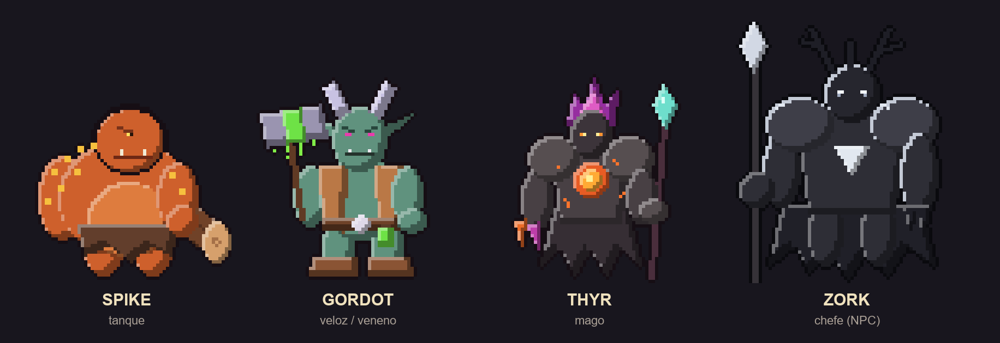

# GDD: Not your Dungeon (resumo)

Resumo do GDD (`GDD_Not_your_Dungeon.docx`, versão de 15/11/2026). Se houver divergência, vale o documento original.

## Visão geral

- **Gênero:** RPG tático de turno 2D
- **Modos:** single player (Campanha e Sobrevivência). Não terá multiplayer.
- **Público:** 14 a 30 anos, fãs de estratégia e RPG tático
- **Classificação:** 14+ (violência fantasiosa, necromancia, sangue moderado)
- **Plataforma:** PC básico
- **Preço:** gratuito
- **Referências:** Darkest Dungeon, Dungeon Keeper, Pokémon FireRed

### Diferenciais

1. **Inversão de papéis:** o jogador comanda os monstros da masmorra contra grupos de humanos que ameaçam a existência deles.
2. **Recrutamento:** novos aliados vêm principalmente do resgate de monstros capturados ou em perigo.
3. **Combate estratégico:** turnos com fraquezas, stagger, moral dos inimigos, habilidades especiais, magias e combos.
4. **Liberdade dos monstros:** a história fala da luta dos monstros pelo direito de escolher como e onde viver.

## História

Depois de uma grande guerra, o Reino da Humanidade inicia inquisições para exterminar os monstros. **Zork**, Imperador de uma masmorra, decide resistir e proteger os outros monstros. O jogador controla **Spike**, um subordinado da masmorra, que reúne aliados e resgata monstros perseguidos ou capturados.

O objetivo é impedir a extinção dos monstros e recuperar a liberdade deles. Liberdade aqui não significa voltar para as masmorras: cada monstro escolhe o próprio destino, seja o habitat natural, uma masmorra ou um novo refúgio.

## Personagens

| Personagem | Papel | Atributo | Habilidade única |
|---|---|---|---|
| **Spike** | tanque (defesa) | vida adicional | **Muralha de Tronco:** atrai os ataques inimigos por 2 turnos e recebe 30% menos dano |
| **Gordot** | agilidade (veneno) | grande velocidade, tende a agir primeiro | **Martelada Venenosa:** golpe rápido que envenena por 3 turnos; enche mais o stagger de quem já está envenenado |
| **Thyr** | magia | ganha mais experiência | **Chama do Núcleo:** dano mágico em todos os inimigos, com chance de queimadura |
| **Zork** | chefe da masmorra (não jogável) | — | — |

**Aparência**
- **Spike:** ogro corpulento de pele laranja-avermelhada, manchas amarelas nos ombros, presas aparentes, tanga de couro e um tronco como clava.
- **Gordot:** orc ágil de pele verde-azulada, chifres claros, olhos magenta, colete de couro, frasco de veneno no cinto e martelo coberto de veneno.
- **Thyr:** espectro de armadura carbonizada, núcleo de fogo no peito, rachaduras de lava, chama roxa no elmo, farrapos (flutua) e cajado de cristal.
- **Zork:** rei-sombra de armadura escura com coroa de chifres, olhos brancos brilhantes, capa em farrapos e lança.

Os monstros têm **especialidades naturais** (combate físico, defesa, magia, agilidade ou suporte), mas também podem aprender habilidades de fora da especialidade.

**Inimigos**
- **Mercenário Lacaio:** ataca com espada. É o combatente humano comum.
- **Mercenário Líder:** tem mais vida e usa uma maça de duas mãos. Lidera pequenos grupos.
- Os inimigos têm fraquezas e resistências diferentes.

## Mecânicas

- **Atributos:** HP, ataque físico, defesa física, poder mágico, resistência mágica, velocidade e resistência a stagger.
- **Progressão:** todos ganham experiência, sobem de nível e aprendem habilidades.
- **Combate:** tela própria, com aliados de um lado e inimigos do outro, sem grade e sem deslocamento. A ordem dos turnos é individual, pela velocidade.
- **Ações:** Atacar, Habilidades especiais (usos limitados por combate), Magias (gastam MP), Defender, Itens e Combos.
- **Magias e MP:** cada monstro tem o próprio MP e pode equipar no máximo **4 magias**, trocadas fora do combate. Depois do combate o MP volta parcialmente; nos pontos de descanso, HP e MP voltam por completo.
- **Stagger:** cada inimigo tem uma barra. Explorar fraquezas enche mais rápido. Quando a barra enche, o inimigo perde o próximo turno e recebe mais dano.
- **Moral:** o grupo inimigo tem uma barra coletiva de moral, que cai com mortes, a derrota do líder, combos sofridos ou muita vida perdida. Com moral baixa, os inimigos podem ter medo, fugir ou se render.
- **Crítico:** num acerto crítico há um evento de tempo com um botão. Acertar o momento aumenta o dano.
- **Recrutamento:** resgatar monstros, cumprir tarefas e negociar com NPCs.
- **Grupo:** até **4** monstros na equipe ativa. Os outros ficam na **base**, o refúgio da comunidade, onde se preparam equipe, equipamentos e magias.
- **Necromancia:** mecânica futura, não é a forma principal de recrutamento.

## Estrutura

5 masmorras, cada uma com 5 fases (seções da masmorra).

| Masmorra | Gestalt (emoções) |
|---|---|
| 1 (Caverna Destruída) | Tristeza e fúria |
| 2 | Ingenuidade e coragem |
| 3 | Arrependimento e solitude |
| 4 | Esperança, fúria e coragem |
| 5 | Medo, superação e vingança |

### Masmorra 1: Caverna Destruída

| Fase | Conteúdo |
|---|---|
| 1 | Tutorial: cutscene com o chefe, pegar cristais, salvar um monstro, lutar com mercenários |
| 2 | Corredor, sala de tesouros (equipamentos e dinheiro), sala com kobolds mercadores |
| 3 | Corredor até a biblioteca: 3 magos mercenários saqueando pergaminhos (combate); dá para coletar pergaminhos de magia |
| 4 | Corredor até a sala de prisões: um golem preso (possível recrutamento) |
| 5 | Câmara principal com um grupo de mercenários |

**Fase 1 em detalhe**
1. **Sala do chefe:** Zork manda Spike coletar cristais para enfeitar o trono (diálogo).
2. **Sala vazia:** caminhada pelo cenário da masmorra.
3. **Sala dos cristais:** Spike pega uma picareta e minera. Na 3ª picaretada vem uma flecha da tela 4. Se continuar minerando, a 8ª picaretada dá um item especial (easter egg).
4. **Resgate:** um monstro morto (cenário) e outro sendo capturado por 2 mercenários. Spike vence, cura o monstro e o recruta.
5. **Chefe da fase:** 2 mercenários básicos + 1 Mercenário Básico nível 2. Dá para usar especial e especial combo.

## Controles

**Setas / WASD** para mover, **Z** para confirmar ou interagir, **X** para voltar ou cancelar.

## Pendências no GDD

- Data de publicação
- Nome da masmorra de Zork
- Detalhes das masmorras 2 a 5
